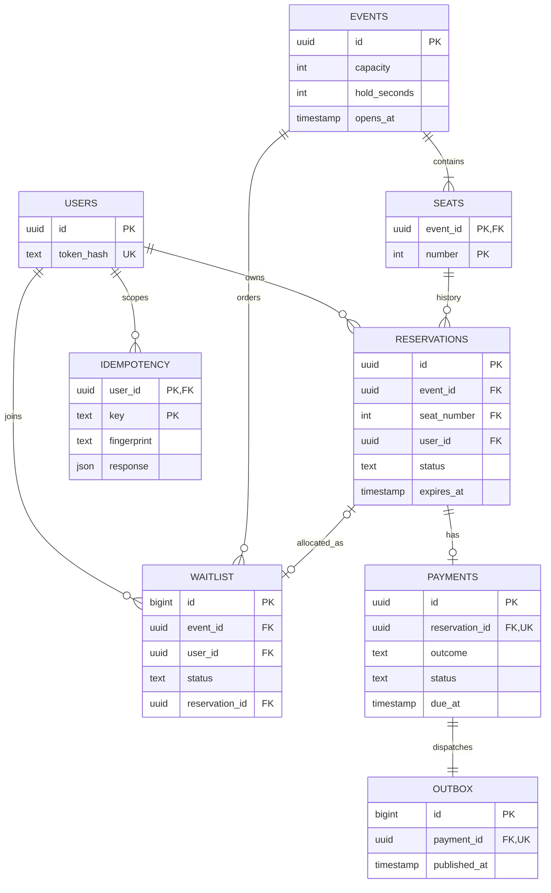
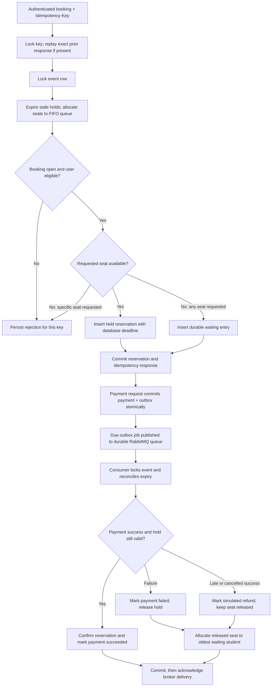

# Design and invariants

PostgreSQL is the authority. A seat is occupied exactly when a reservation is `held` or `confirmed`. Two partial unique indexes independently prohibit two active reservations for a seat and two active seats for a student in one event. Even an accidental SQL write bypassing the application cannot double book a seat.

All mutations, payment settlement, expiry, and waitlist allocation lock their event row with `SELECT ... FOR UPDATE`. Different events proceed independently. Within an event, a transaction expires old holds, serves waiting students, then makes its requested transition. The lock stays held until commit. Reads for availability use a one-second Redis cache and can be stale; reservation decisions always read PostgreSQL. Redis loss cannot cause overselling.

This deliberately favors simple, auditable correctness over maximum throughput for one concert. It does not claim 10,000 simultaneous database transactions: the load harness sends 10,000 requests using a bounded concurrency of 100. Nginx, two API processes, and connection pools provide backpressure. A row lock serializes the critical section for a hot event. See measured results before drawing capacity conclusions.

## Entities

## Booking workflow

Reservation transitions: `held -> confirmed | cancelled | expired | payment_failed`; `confirmed -> cancelled`. Terminal reservations never become active again. Failed payment releases the seat; a student may book again under a new key. The original reservation allows one payment attempt. Payment transitions: `pending -> succeeded | failed | refunded`; `succeeded -> refunded` on cancellation. Refunds and charges are simulated, with no real money involved.

## Expiry and fairness

The worker checks expired holds every second. Every booking mutation and individual status read also reconciles expiration inline. Confirmation checks the database deadline at the update itself, so a stopped scheduler cannot extend a hold. Expiry is based on PostgreSQL `clock_timestamp()`, not a client's clock or transaction-start time. Availability ignores already-expired holds even before physical cleanup.

The queue is durable SQL ordered by increasing entry ID. IDs are assigned under the event lock, giving FIFO order for accepted queue entries, not network arrival times. All released seats go to waiting students before fresh requests. Queue allocations are new temporary holds, requiring payment within the same event's hold duration. Students poll their queue status and history; notifications are not implemented. A cancelled waiting entry is skipped. A specific-seat conflict returns 409 instead of joining the queue, which allocates any seat.

## Idempotency and recovery

Booking, payment, confirmation, reservation cancellation, and waitlist cancellation require a key of 8-128 characters. Keys are scoped to the authenticated user across routes. A transaction-level advisory lock serializes the same user/key even before its row exists. The stored route/body fingerprint prevents accidental key reuse with a different request. The action and its original HTTP code/body commit together. Replays return the original snapshot, even if the reservation later changes; GET returns current state. Auth/validation failures before execution are not stored. Business rejections are stored; use a new key for a new attempt after conditions change. Keys have no automatic retention cutoff in this implementation.

A payment and its outbox row commit together. Only due jobs are sent, so delayed payments do not sleep inside a request or block a consumer. The publisher uses row locking with `SKIP LOCKED`, persistent messages, a durable queue and publisher confirms. It marks an outbox row published only after the broker confirms. A crash between broker confirmation and SQL commit can publish twice, which is safe: the consumer checks the locked payment's state and commits before acknowledging. Connection failures are retried. A broker outage leaves accepted payments pending in the outbox. This is at-least-once delivery with idempotent state transitions, not a claim of distributed exactly-once delivery.

## Scaling and limits

- Add API replicas behind a service-aware proxy; shared DB locks and constraints work across processes. Pool limits are 20 connections per process; budget PostgreSQL connections before adding replicas. Current Compose uses two API processes and one worker.
- For much higher throughput on one event, replace its broad lock with per-seat row locks, `SKIP LOCKED` allocation and a carefully designed queue allocator. Keep database unique constraints, a stable lock order, and rerun fairness/expiry races. Shard by event when events outgrow one database.
- Batch availability, add PgBouncer, and instrument lock waits and queue age. Redis is deliberately only an advisory cache. Use replicas for historical reads when appropriate, keeping writes and fresh ownership checks on the primary.
- Anonymous bearer registration demonstrates ownership, not campus identity verification. No login recovery, token rotation, registration abuse protection, queue notifications, real payment provider, webhooks, or refund reconciliation. Protect a public deployment with campus authentication, request quotas, TLS and secret management.
- Readiness requires the authoritative database. Optional Redis or broker failure does not prevent booking; payments may remain pending. Workers retry outages but have no separate readiness endpoint or operational metrics. Monitor logs, outbox age, and RabbitMQ queue depth in an operated deployment.
- Single-host Compose has persistent database/broker volumes but no automatic host failover or backup service. The schema bootstrap is idempotent initialization, not a versioned migration system. Add migrations and backup/restore checks before changing a deployed schema.
- UUIDs and random 256-bit bearer tokens are generated server-side; only token hashes are stored. Admin event creation uses a separate generated secret. Service ports remain internal; the default proxy binds loopback.

## Primary references

- [PostgreSQL row locks](https://www.postgresql.org/docs/17/explicit-locking.html)
- [RabbitMQ acknowledgements and publisher confirms](https://www.rabbitmq.com/docs/confirms)
- [FastAPI container deployment](https://fastapi.tiangolo.com/deployment/docker/)
